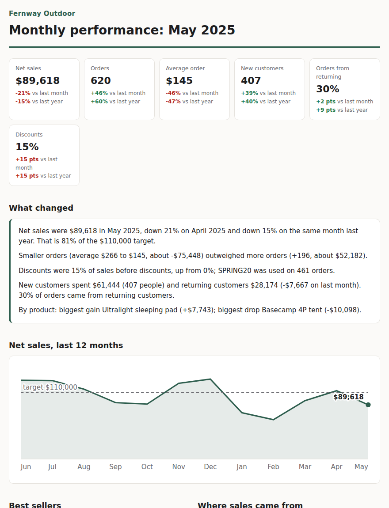

# RetainerKit

The monthly e-commerce report a freelance analyst delivers on retainer, templated per client.
One config file per client, their Shopify orders export in, a finished report out. DuckDB,
Jinja, inline SVG.

This file is the reference: what exists and how it works. `RUNBOOK.md` is the procedures,
`CLAUDE.md` the agent rules, `TASK.md` the open items.

## What it is

**Sample reports: [m4dd0ck.github.io/retainer-kit](https://m4dd0ck.github.io/retainer-kit/)**
(three months for a synthetic outdoor store; May is the interesting one)



A client is a folder: a `client.toml` and their Shopify "Export orders" CSVs. `retainer report`
reads every export in the folder, rebuilds the orders, computes the month against last month and
the same month last year, writes the sentences that explain the change, and renders one HTML
page with inline SVG charts. A sample store (`retainer demo`) exists so the whole thing runs
with no real client data, and `retainer site` builds the sample reports for GitHub Pages.

## Why it exists

Retainer work is the same report every month for every client. The value is in the reading, not
the assembling, so the assembling should take a minute: drop the new export in, run one command,
spend the time on what the numbers mean. Client two should take an hour to set up, not a week.

## Quick start

Needs Python 3.12+ and [uv](https://github.com/astral-sh/uv).

```bash
uv sync
uv run retainer init clients/acme --name "Acme Goods"   # folder + starter client.toml
# put Shopify "Export orders" CSVs in clients/acme/exports/ (overlapping months are fine)
uv run retainer report clients/acme --month 2025-05     # -> clients/acme/reports/2025-05.html
```

`client.toml` holds everything that differs between clients:

```toml
name = "Acme Goods"
currency = "USD"
report_title = "Monthly performance"
brand_colour = "#2e5e4e"
monthly_sales_target = 50000       # optional
exclude_test_orders = true
test_order_emails = ["test@acme.example"]
```

`clients/` is gitignored: client exports hold customer emails and never belong in the repo.

Try it on the sample store: `uv run retainer demo` then
`uv run retainer report demo_clients/fernway --month 2025-05`.

## Commands

All run as `uv run retainer <command>`. The table is regenerated from `retainer --help` by the
doc check; edit the help strings in `src/retainer_kit/cli.py`, not this table.

<!-- generated:commands start -->
<!-- do not hand-edit: regenerated by doc-check --fix -->
| Command | What it does |
|---|---|
| `retainer init` | Set up a client: folder, exports/ and a starter client.toml. |
| `retainer report` | Write reports/<month>.html for one client. |
| `retainer demo` | Create a sample client with two years of exports. |
| `retainer site` | Build the sample reports site. |
<!-- generated:commands end -->

`init` and `report` take the client folder as their argument; `report` needs `--month YYYY-MM`.
`demo --out` and `site --out` choose where the sample store and the Pages site are written
(defaults `demo_clients/fernway` and `site/`, both gitignored).

## How it works

### What's in the report

- **Headline figures**: net sales, orders, average order, new customers, share of orders from
  returning customers, discounts; each against last month and the same month last year (shares
  compared in percentage points).
- **What changed**: a few sentences written from the numbers. Sales change is split exactly into
  an orders effect and an order-value effect (they sum to the headline change), and when the two
  pull opposite ways the report says which won. Discounts are mentioned when their share moves,
  with the code behind it.
- **Trend, best sellers, markets**, and **cohorts**: how many first-time customers come back in
  the following months.
- **Footer**: how net sales and "new" are counted, the date range of the exports, and how many
  cancelled and test orders were left out, so any number can be checked against Shopify.

### Shopify export quirks handled

- One row per line item, with order fields (email, totals, status) filled only on the first row
  of each order; orders are rebuilt from the non-blank values.
- The same order in two monthly exports: the newest file wins, since it carries later refunds.
- `Created at` like `2025-05-03 14:22:05 -0400`: the store's local date is used.

## Layout

```
src/retainer_kit/
├── config.py      # client.toml
├── shopify.py     # export loading and cleaning
├── metrics.py     # monthly summary, customers, cohorts
├── drivers.py     # orders vs order-value split, product movers
├── narrative.py   # the what-changed sentences
├── charts.py      # inline SVG
├── report.py      # assembles the page
├── demo.py        # the sample store's exports
├── site.py        # sample reports for Pages
├── templates/     # report and site index (Jinja)
└── cli.py         # retainer init | report | demo | site
tests/             # one file per module, plus onboarding a second client
assets/            # the README screenshot
```

Not in git: `clients/` and `demo_clients/` (customer data), `site/` (built by CI).

## Outside the repo

| Thing | Where | Notes |
|---|---|---|
| Sample reports site | GitHub Pages for this repo | built by `ci.yml` on every push to `main` from the synthetic store; no secrets |
| Client folders | wherever the analyst keeps them | never in this repo; a folder is one `client.toml` plus an exports directory |

## Vocabulary

- **Net sales** = Subtotal (after discounts, before shipping and tax) minus Refunded Amount.
- **New customer** = first order in the exports provided. Older history is often not exported,
  so the report says so.
- Cancelled orders and orders from `test_order_emails` are excluded and counted.

## Decisions

- **2026-07-09** The sales change is decomposed exactly into an orders effect and an order-value
  effect, and the narrative names the winner, so the sentences never contradict the figures.
- **2026-07-09** Shares are compared in percentage points, never as relative changes.
- **2026-07-13** Client folders and the demo store are gitignored and report inputs are
  validated: exports hold customer emails.
- **2026-07-15** The Pages site is rebuilt from the synthetic store in CI, so it needs no secrets.
- **2026-10-20** Four-file skeleton.

## History

- **2026-06-20** First commit: client config, Shopify loading.
- **2026-07-05** v0.1.0: metrics and the first report.
- **2026-07-09** v0.2.0: narrative, charts, the four CLI commands.
- **2026-07-15** v0.3.0: CI with the Pages deploy.
- **2026-10-06** v1.0.0: feature set done.
- **2026-10-17** CI on the shared template with locked sync.
- **2026-10-20** Four-file skeleton.

## Development

```bash
uv sync
uv run ruff check . && uv run ruff format --check .
uv run mypy src/
uv run pytest
```

The full list is `RUNBOOK.md` §Validate. Paths the docs name that never exist in a checkout
(client folders) are listed in `.doc-check-ignore`.

## Pointers

- `RUNBOOK.md`: on open, on close, the monthly report, release, deploy, restore.
- `CLAUDE.md`: rules for agents working here.
- `TASK.md`: what is open.
- `~/developer/hq/CONVENTIONS.md`: release and commit conventions across the owner's repos.

## License

MIT
